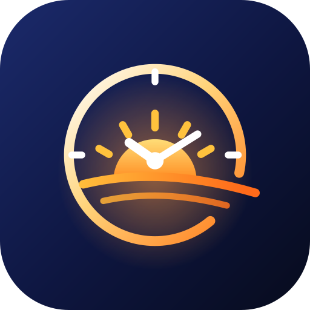

<p align="center"></p>

# SunCanvas — Sunrise, Sunset & Widget Studio for Android

Accurate sunrise, sunset and daylight for any place on Earth — calculated on the phone, offline — plus a Widget Studio for designing beautiful, independent home-screen widgets.

**Stack:** Kotlin · Jetpack Compose (Material 3) · Jetpack Glance + AppWidget APIs · Room · DataStore · WorkManager · Fused Location (foreground, approximate OK) · kotlinx.serialization. No account, no analytics, no API keys.

## Features

| Area | What's included |
|---|---|
| Solar engine | NOAA algorithm, local-day event search; sunrise, sunset, solar noon & midnight, civil/nautical/astronomical twilight, golden & blue hour, elevation & azimuth, day-length change, polar day/night, equinoxes & solstices. Validated against JPL DE421 (mean error ≈ 1 s). |
| Locations | First-run choice: detect location / search city / enter coordinates. One-shot foreground location, offline reverse geocoding, saved last location, default location, custom labels (Home, Office…), favorites, reordering. |
| Cities | 34 000-city offline database (GeoNames) with same-name disambiguation ("Paris, Texas"), optional online search, IANA time zones resolved offline. |
| Home | Location header + refresh, live clock, sunrise/sunset cards, sun arc with day/night states, % of daylight, next event, info tiles, twilight table, sun-position compass, upcoming seasons. |
| World Clock | Digital or analog clocks with day/night, offsets, and a ±12 h day/night comparison timeline with a time scrubber. |
| Calendar | Day / week / month / year views, elevation chart, yearly sunrise–sunset–daylight chart, date comparison. |
| Widget Studio | 21 templates, 12 layouts, 12 shapes, 12 background types (incl. photo with crop/brightness/opacity, glass, scenes, live sky), 12 palettes + HEX color picker, 11 bundled fonts with weight/size/spacing/case, element toggles, alignment and spacing, opacity controls, contrast warning, live preview on sample wallpapers at 9 sizes, save/duplicate/reset, add to home screen, per-widget independent configs, reconfigure from the home screen. |
| Widgets | Four picker entries (2×1, 2×2, 4×2, 4×4), freely resizable from 1×1; native TextClock & Chronometer for always-exact time; event-driven + periodic refresh; survives reboots. |
| Reminders | Sunrise/sunset/golden-hour/blue-hour/solar-noon with custom offsets, per-reminder toggles, exact alarms when allowed. |
| More | Light / dark / system / automatic-by-sunrise theme, 12/24 h, date formats, backup & restore (JSON), accessibility labels, contrast-aware design. |

## Download the APK

Every push to `main` builds a debug APK in GitHub Actions:

1. Open the repository → **Actions** → latest **Android build** run.
2. Download the **SunCanvas-debug-apk** artifact (a zip), unzip it, and copy the `.apk` to your phone.
3. Open it on the phone and allow "Install unknown apps" for your file manager when asked.

The `widget-renders` artifact contains PNGs of every widget template at several sizes and times of day, rendered by the real widget engine in CI.

## Build locally

Requirements: Android Studio Ladybug or newer (or JDK 17 + Android SDK 35).

```bash
git clone https://github.com/rady-radwan/suncanvas.git
cd suncanvas
./gradlew assembleDebug          # app/build/outputs/apk/debug/app-debug.apk
./gradlew :core-solar:test :app:testDebugUnitTest
```

Install on a connected phone: `./gradlew installDebug`.

### Release signing (optional)

Signing secrets are never stored in the repository. Set these environment variables (locally or as GitHub secrets) and run `./gradlew assembleRelease`:

`SUNCANVAS_KEYSTORE_PATH`, `SUNCANVAS_KEYSTORE_PASSWORD`, `SUNCANVAS_KEY_ALIAS`, `SUNCANVAS_KEY_PASSWORD`.

## Repository layout

```
core-solar/      Pure-Kotlin solar engine + reference tests (JPL DE421 via Skyfield)
app/             Android app (Compose UI, Room, Glance widgets, reminders)
branding/        Logo sources (SVG) and store icon
docs/            Architecture, design system, accuracy, branding
tools/           Scripts to rebuild the city DB, reference data and font resources
.github/         CI workflow (build APK, run tests, upload widget renders)
```

## Documentation

* [Architecture & widget strategy](docs/ARCHITECTURE.md) — modules, data flow, how widgets render and update, platform limits
* [Design system](docs/DESIGN_SYSTEM.md)
* [Accuracy](docs/ACCURACY.md) — method, reference comparison, expected differences
* [Branding / renaming](docs/BRANDING.md)

## Roadmap

* Phase 1–5 are implemented in this first version (core, cities, widgets, studio, calendar, reminders).
* Next: Roborazzi screenshot tests for app screens, more languages (strings are centralised for localisation), tablet two-pane layouts, Play Store listing assets.

## Credits & licenses

City data © [GeoNames](https://www.geonames.org/) (CC BY 4.0). Online search: [Open-Meteo Geocoding](https://open-meteo.com/). Fonts under the SIL Open Font License 1.1 (texts in `app/src/main/assets/licenses`). Solar equations: NOAA Global Monitoring Laboratory / J. Meeus.
